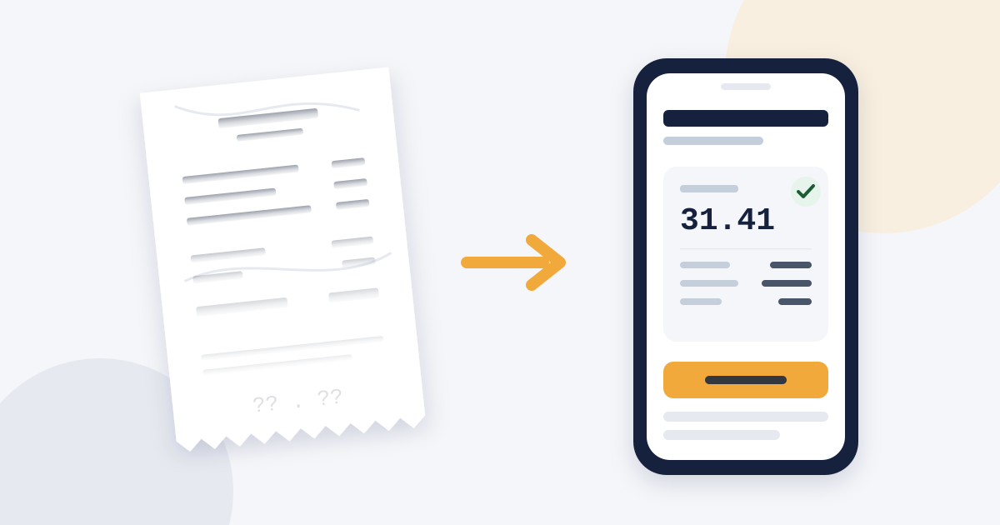

It usually happens at the worst moment. The dishwasher stops working eleven months after you bought it, and the repair shop asks for proof of purchase. Or a store will only take a return "with the receipt." Or your tax preparer asks what that $400 at the hardware store was for.

The receipt is gone. It was in a coat pocket, a kitchen drawer, the car's door pocket, or an email you can't find anymore. A piece of paper you didn't think twice about is suddenly the one thing you need.

This post is about why that little slip matters more than it looks, and how to keep the important ones without turning your life into a filing system.

## A receipt is a record, not just paper

A receipt answers five questions that are surprisingly hard to prove any other way:

- **What** you bought
- **Where** you bought it
- **When** you bought it
- **How much** you paid, including the tax
- **How** you paid: which card, cash, or a gift card

Your bank statement covers only part of that. It shows an amount and a store name, often abbreviated beyond recognition, but not what you bought or what the tax was. If you paid cash, there's no bank record at all. The receipt is often the only complete record of a purchase.

## Five moments when a receipt suddenly matters

**1. Returns and exchanges.** Many stores accept returns without a receipt only for store credit, at the lowest recent price, or not at all. With the receipt, you get your money back on the card you paid with.

**2. Warranties and repairs.** Manufacturer warranties usually run from the date of purchase. Without proof of that date, a repair under warranty can turn into a repair you pay for. This matters most for the things that cost the most: appliances, electronics, tools, furniture.

**3. Insurance claims.** After a theft, a fire or water damage, an insurer will want to know what you owned and what it was worth. Receipts for larger purchases are the clearest evidence you can give.

**4. Taxes and business expenses.** If you're self-employed, run a side business or have rental property, receipts are how you show that an expense was real and what it was for. Even if you don't itemize, some deductions and credits depend on records of what you paid. (Ask your tax preparer which ones apply to you.)

**5. Mistakes and disputes.** Charged twice? Charged the wrong price? Billed for something you returned? A receipt turns a "he said, she said" with a store or a card company into a quick fix.

## Why receipts disappear

It isn't carelessness. Receipts are built to get lost:

- **Thermal paper fades.** Most till receipts are printed on heat-sensitive paper. Light, heat and time can make the print fade until it's unreadable, sometimes within a year or two. The receipt you kept so carefully may be blank when you need it.
- **Email receipts get buried.** Online orders, subscriptions and bills arrive by email, mixed in with newsletters and promotions. Finding one from last spring means remembering exactly what to search for.
- **They live in too many places.** Wallets, bags, drawers, glove boxes, inboxes, photo galleries. When you need one, you don't know where to start.

## Which receipts to keep

You don't need every receipt for a pack of gum. A simple rule of thumb:

| Keep | Think about it | Usually fine to toss |
|---|---|---|
| Anything with a warranty: appliances, electronics, tools | Clothing and gifts you may return | Small everyday purchases you won't return |
| Larger purchases you'd want to prove for insurance | Restaurant receipts if you might expense them | Duplicate copies of the same purchase |
| Business, rental or work-related expenses | Medical and pharmacy receipts | |
| Home improvements and repairs | Charitable donations | |

How long to keep them depends on what they're for: until the return window or warranty ends for most purchases, and for tax-related receipts, generally at least three years after you file. Some situations call for longer, so check with your tax preparer.

## The two-second habit

The easiest receipt to keep is the one you deal with right away:

1. **Paper receipt:** take a photo or scan it before you leave the store, or as soon as you're home. Then the paper can go.
2. **Email receipt:** forward it to one place the moment it arrives, instead of leaving it in your inbox.
3. **Keep them together.** One place, searchable by store, date or amount, beats five places you have to remember.

That's what we built ReceiptWhere for. You scan, share or forward a receipt, and it reads the store, date, total, tax and how you paid. It checks those numbers against the receipt itself, and keeps the original image next to what it read. When something is unclear, it asks you instead of guessing. When the day comes that you need a receipt, you search for it instead of digging for it.

## The short version

A receipt is a small thing until the day it isn't. Keep the ones that protect your money, and make keeping them take seconds, not effort.

You never know when you'll need a receipt. But you'll be glad you kept it.

*This post is general information, not tax or legal advice.*
